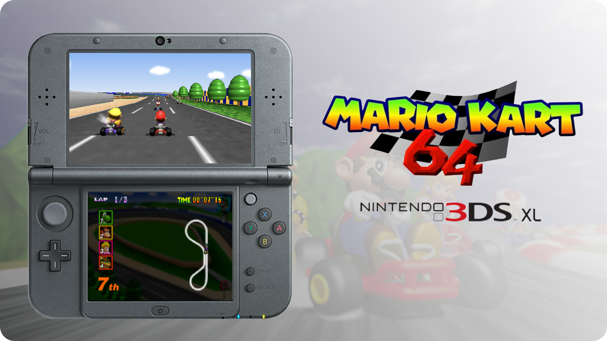

<h1 align="center">Mario Kart 64 3DS</h1>

<p align="center">
  <strong>Pick your kart. Bring the race with you.</strong><br>
  Mario Kart 64, adapted for Nintendo 3DS.
</p>

<p align="center">
  <a href="#download-and-installation">Download</a> ·
  <a href="#features">Features</a> ·
  <a href="#documentation">Documentation</a> ·
  <a href="CHANGELOG.md">Changelog</a> ·
  <a href="CONTRIBUTING.md">Contribute</a> ·
  <a href="#community-and-bug-reports">Community</a>
</p>

<p align="center">
  <a href="https://github.com/EstebanPdN/mario-kart-64-3ds/releases/tag/v1.5"></a>
  <a href="#download-and-installation"></a>
  <a href="platform/3ds/update/README.md"></a>
  <a href="#license-and-legal-notice"></a>
</p>

<p align="center">
  
</p>

<p align="center">
  <a href="https://estebanpdn.github.io/"></a>
  <a href="https://discord.gg/BjbzfRYpV"></a>
</p>

Native Nintendo 3DS port of Mario Kart 64, based on
[SpaghettiKart](https://github.com/HarbourMasters/SpaghettiKart). It is designed
specifically for the 3DS family, with a dual-screen interface and hardware-aware
rendering, audio, and memory profiles.

No ROM, ROM fragment, save file, or extracted Nintendo game data is distributed
with this project. You must provide your own legally obtained USA Mario Kart 64
ROM.

The 2.0 series is experimental; physical Old/New 3DS compatibility and sustained
frame-rate targets remain under validation. [Choose a release](https://github.com/EstebanPdN/mario-kart-64-3ds/releases).

Made with help from Codex.

## Features

<table>
  <tr>
    <td width="50%" valign="top"><strong>Race your way</strong><br>Grand Prix, Time Trial, solo VS and Battle, CPU opponents and AUTO spectator mode.</td>
    <td width="50%" valign="top"><strong>Made for two screens</strong><br>Native top-screen racing with five HUD layouts, course maps and touch menus below.</td>
  </tr>
  <tr>
    <td width="50%" valign="top"><strong>Tune the presentation</strong><br>Adjust render scale, distance, filters and Performance / Quality profiles.</td>
    <td width="50%" valign="top"><strong>Keep it current</strong><br>Built-in Stable / Experimental updates, preserved settings and local diagnostics.</td>
  </tr>
</table>

### Feature details

* Native 400×240 resolution
* Adjustable 0.50×–1.00× render scale
* Low, Normal, and High render distance
* Five HUD layouts
* Bilinear, Blur, and CRT filters
* Dual-screen HUD and touch controls
* Optimized PICA200 rendering
* Original 30 Hz simulation with adaptive frame interpolation
* On-device ROM validation and extraction
* Solo VS and Battle with CPU opponents; AUTO spectator mode and random cups
* Modern Logic, held-B reverse and C-Stick Turbo from 2x to 5x
* Performance/Quality profiles with an Advanced display menu
* Original, bilinearly Scaled and hand-authored Modified UI texture modes
* Scrolling course maps and adjustable lower-menu background blur
* Diagnostic dumps with `L + R + SELECT` and configurable SELECT actions
* Built-in Stable/Experimental updater

Multiplayer is planned but is not currently available.

## Performance

Mario Kart 64 retains its original 30 Hz game simulation. On Old and New Nintendo
3DS, in either supported resolution, the port may render an additional
matrix-interpolated midpoint frame when recent frame, GPU, audio, and resource
activity leave enough headroom. It automatically falls back to the required
30 Hz keyframes under pressure.

The midpoint path is adaptive; it is not a promise of a fixed or sustained
60 FPS mode.

Display > Render adjusts internal resolution from 0.50x through 1.00x and
scales it to the complete top screen. Bilinear uses a single GPU
presentation pass, Blur uses four lightweight samples, and CRT combines
bilinear scaling with a small procedural scanline and shadow-mask pattern.
A 1.00x render scale with Bilinear selected keeps the original direct presentation
path and does not allocate the intermediate target.

The renderer cleans exact Fast3D vertex and texture ranges through the local
ARM11 kernel path, with the established GSP service call retained as a
compatibility fallback. Citro2D frames capture and clean only their bounded
linear vertex/index allocation span through the same local path instead of
flushing the complete linear heap through a blocking GSP round trip. Unchanged
filter-presentation geometry is retained between frames.
Vertex colors use a GPU-native byte format, reducing the fixed Fast3D vertex
allocation and per-frame vertex traffic by 25% without changing the intended
color precision. Audio synthesis writes directly into a reserved NDSP wave
buffer and uses the same clean-only ownership transfer instead of producing and
copying an intermediate block. These changes reduce contention and memory
traffic on both hardware profiles; sustained performance still requires
physical-hardware measurement.

Render distance is independent of scale: Low uses 75% of that course's far
distance, with a fog transition over the final quarter. Normal retains the
native course distance and fog; High removes the additional port distance pass.
Only fully distant depth-tested triangles are rejected; intersecting polygons
remain to avoid holes. Gains
are scene-dependent and must be measured separately on Old and New hardware.

HUD layouts are selectable without restarting:

| Layout | Top screen | Bottom screen |
| --- | --- | --- |
| Clean | Clear race view | Existing complete race HUD |
| MK7 | Item left, position upper right | Lap, time, standings, map |
| MKDS | Item left, lap upper right, position lower left | Time, standings, map |
| MKDS 2 | Item left, position lower left | Lap, time, standings, map |
| Classic | Rebalanced complete HUD at native display resolution | Complete race HUD |

Top-screen race widgets fade in over one second after the countdown. The empty
item frame remains visible between pickups. Top-screen item, lap,
and position elements are larger, with a dark position shadow. Lower standings
use separated portraits and a larger two-column finish layout. Multiplayer
keeps the native per-viewport HUD. Y cycles all five complete layouts, one
step per press, and wraps from Classic to Clean. MKDS 2 remains the default.

Display offers Performance, Quality and Custom profiles. Both presets retain
100% render scale, the original MKDS 2 layout and a light menu blur. Performance
selects Low distance, a 30 FPS presentation target and static lower-menu maps.
Quality selects High distance and a 60 FPS target on New 3DS, or Normal
distance and a 30 FPS target on Old 3DS, with scrolling maps enabled. The main Display page contains Profile, Aspect Ratio, HUD Layout, Render,
Distance, Frame Limiter and Advanced. Advanced exposes filters, loading artwork,
HUD meters, menu blur, scrolling maps, the warning widget and UI texture style. Manual graphics changes, including Y's HUD shortcut, select Custom
without resetting other values. Existing settings are migrated and preserved.
Profiles preserve gameplay settings and SELECT bindings. The 60 FPS setting
allows adaptive presentation; it does not change the original 30 Hz simulation
or guarantee a sustained frame rate.

Advanced > Textures offers Original, Scaled and Modified. Scaled bilinearly
resamples the owner's archive artwork. Modified includes newly authored HUD
labels/counters and all twenty course/battle maps at three settled sizes.
Portraits, item/rank sprites and the general menu alphabet retain the original
appearance where a hand-authored replacement is unfinished. All three modes
share the corrected title credit. See the [sprite guide](platform/3ds/docs/NATIVE_SPRITES.md).

Single-player VS uses seven CPU opponents; single-player Battle uses three.
AUTO watches CPU-controlled GP, VS or Battle play and supports switching the
observed racer. Random cups use four distinct courses, with an optional all-course
selection. Modern Logic controls the new item/CPU rules and held-B reverse;
solo Battle retains the navigation and inventory needed by its CPU opponents
even when that option is off.

The renderer compiles immutable combiner plans once per material. Distance fog
skips batches entirely before the start of its ramp and avoids redundant fog
texture binds within a 3D pass. These changes reduce repeated CPU/state work;
real-hardware FPS gains have not yet been measured.

Extraction buffers archive writes and stores tiny entries without deflation.
All payload/CRC validation and atomic completion remain enabled. The progress
screen redraws at most ten times per second while retaining every log message.

Course Data uses an enlarged scrolling course list and a dual-screen details
view with records, preview and map above, and course actions below. Time Trial
and Grand Prix results use centered text and shadows. Time Trial ghosts use the
two original save slots in `sd:/3ds/MK64/controller-pak.bin`.

Startup shows a small animated Lakitu with a checkered flag at the center of
the upper screen, with black backgrounds on both screens. Its 32 native frames
are loaded from your O2R and cached in `sd:/3ds/MK64/cache/loading-lakitu-v1.bin`.
The cache rebuilds when missing, damaged, or when the archive changes. Its
memory and animation worker are released before gameplay. First-time ROM
extraction keeps its progress display. Course loading artwork remains optional
under Display > Advanced > Show loading screens. Errors remain visible.

<a id="installation"></a>

## Download and installation

<p>
  <a href="https://github.com/EstebanPdN/mario-kart-64-3ds/releases/download/v1.5/mk64-3ds-v1.5.cia"></a>
  <a href="https://github.com/EstebanPdN/mario-kart-64-3ds/releases/download/v1.5/mk64-3ds-v1.5.3dsx"></a>
</p>

**Stable: [v1.5](https://github.com/EstebanPdN/mario-kart-64-3ds/releases/tag/v1.5).**

Download either the CIA for installation with FBI or the full 3DSX application
for the Homebrew Launcher from the
[latest release](https://github.com/EstebanPdN/mario-kart-64-3ds/releases/latest).

Create this folder on your SD card:

```text
sd:/3ds/MK64/
```

Place your USA Mario Kart 64 ROM in that folder and name it:

```text
mk64.z64
```

The ROM must use the `.z64` byte order. ROMs in another byte order can be
converted with the [Hack64 ROM Swapper](https://hack64.net/tools/swapper.php).

### Automatic extraction

Launch the port with the ROM in place. The 3DS validates it and creates:

```text
sd:/3ds/MK64/mk64.o2r
```

The first extraction can take a long time, so keep the console charged. You can
close the lid while extraction continues. Press `START` to cancel, remove the
incomplete output, and exit safely. Later launches reuse the completed archive.

### Desktop extraction

For a faster setup, use
[SpaghettiKart](https://github.com/HarbourMasters/SpaghettiKart) on a computer
to create `mk64.o2r`, then copy it to `sd:/3ds/MK64/` alongside your ROM:

```text
sd:/3ds/MK64/mk64.z64
sd:/3ds/MK64/mk64.o2r
```

## Controls

| Nintendo 3DS | Function |
| --- | --- |
| Circle Pad | Control Stick |
| A | Accelerate; held acceleration resumes after Continue |
| B | Brake; hold to reverse with Modern Logic on, original reverse otherwise |
| R | Hop / Drift |
| L | Use item / Open Options from Game Select |
| X | Hold for rear view during manual races |
| Y | Cycle Clean / MK7 / MKDS / MKDS 2 / Classic during manual races |
| ZL / ZR | Unassigned |
| C-Stick | Hold for Turbo (2x–5x); release for normal speed |
| Touch Screen | Navigate bottom-screen menus |
| SELECT | Camera distance by default; optional dump or live lower-screen overlay |
| L + R + SELECT | Expanded diagnostic dump; takes priority over SELECT alone |
| START | Start / Pause / Continue; skip award ceremony; cancel extraction |

Developer > Select for dump and Select for overlay are mutually exclusive.
Both default to off. The overlay remains live while racing and preserves driving
inputs and C-Stick Turbo. SELECT retains the native AUTO/random-cup actions in
their menus. Gameplay > Turbo speed uses a touch-adjustable 2x–5x slider.

## Diagnostics and bug reports

If you encounter a crash, graphical bug, or performance problem, press
`L + R + SELECT`, or use Developer > Memory dump. SELECT alone can be configured
for a normal dump in Developer, including during AUTO. The port creates a diagnostic folder under:

```text
sd:/3ds/MK64/dump/
```

Performance captures include `performance.csv` and `performance.txt` with the
latest 256 simulation ticks: CPU/wait/audio timings, submitted images, adaptive
presentation reasons, resource reads, uploads and active settings. Dump pauses
are excluded from the next FPS measurement; `FPS --` indicates its warmup.

New captures are numbered `000-dump-...`, `001-dump-...`, and so on. The
sequence survives restarts and cleanup using `dump-sequence.txt`. Older
captures retain their original names. A paused progress screen appears on the lower screen,
using the current race/menu background and the same font as the FPS counter,
without a separate dark panel.

Developer > Clean dumps deletes all contents of the diagnostic folder, including
expanded RAM captures, and starts a fresh runtime log. Capture numbering remains
monotonic; game data, settings and saves are unaffected.

Before entering the game, the port attempts to load every compressed resource
from the owner-generated O2R archive into RAM in small blocks, without requiring
one large contiguous allocation. On success it closes the SD file handle; kart
angles, course resources and effects then use RAM with decompression and CRC
validation. ZIP names and headers are not duplicated in the payload blocks.
Optional interpolation storage uses the separate linear heap.
The CIA requests expanded application memory on Old 3DS (80MB system mode)
and New 3DS (124MB system mode). Old-model launch/exit can take longer while
the system changes memory mode. The ordinary heap retains at least an 8 MiB
reserve at preload time for later game allocations; this is not a guarantee
of sustained frame rate or a bound on every future allocation.

Use the installed CIA for this path. A 3DSX launcher must grant enough memory;
if the archive cannot fit with the reserve, the validated SD reader remains
available so startup can continue. Diagnostics explicitly report this fallback,
its memory budget and the required bytes; read errors are reported separately.
SD fallback can add loading/gameplay stalls. Existing O2R archives work without
re-extraction. Save data and controller pak reads happen at boot;
intentional save writes and requested diagnostics still use the SD card.

During the game, diagnostic logging uses a bounded 64 KiB RAM ring. Automatic
heartbeats and buffer overflow do not write to SD. Explicit dumps and orderly
shutdown flush it; overflow drops the oldest complete lines with a marker in
the next written log. Resource decoding, texture conversion and GPU work still
have CPU/GPU costs even when physical archive I/O is zero.

The trace includes interpolation acceptance/rejection reasons and matrix counts.
`interpolation.txt` and `matrices-current.csv` / `matrices-previous.csv` describe
the recorder state. `race-start.csv` retains the latest race's initial driving
ticks plus up to 32 countdown ticks even after the rolling trace has moved on.
Do not calculate frame rates across diagnostic-pause epochs.

Hold `L + R` while pressing `SELECT` for an expanded application RAM snapshot with a
region manifest. This additionally captures readable application-owned code,
heaps and stacks; it excludes device registers, VRAM and service shared mappings.
It is larger and slower than a normal capture, and is not a whole-system snapshot.

Share diagnostic folders privately and describe the console model, display mode,
game mode, and what happened immediately before the issue.

## Releases

GitHub releases provide an installable CIA, a full Homebrew Launcher 3DSX, an
FBI QR code, and SHA-256 checksums. GitHub also generates source archives from
each release tag.

[Download the latest release](https://github.com/EstebanPdN/mario-kart-64-3ds/releases/latest)

## Documentation

- [Repository map and maintenance conventions](docs/REPOSITORY.md)


| Guide | Purpose |
| --- | --- |
| [Documentation index](platform/3ds/docs/README.md) | Runtime, configuration, development and validation guides. |
| [Compatibility](platform/3ds/docs/COMPATIBILITY.md) | Supported inputs and current validation limits. |
| [Built-in updater](platform/3ds/update/README.md) | Channels, installation and recovery. |
| [Contributing](CONTRIBUTING.md) | Bounded changes and reproducible checks. |

## Building

Requirements:

- devkitPro
- devkitARM
- libctru
- Citro3D
- CMake 3.20 or newer
- `makerom` and `bannertool` for CIA packaging

Clone the repository with its submodules, then run:

```sh
git submodule update --init --recursive
./platform/3ds/build.sh
```

Build output is written under `build-3ds/game/` by default. Local CIA packaging
may use `MK64_3DS_BANNER_CGFX=/absolute/model.cgfx` and
`MK64_3DS_BANNER_AUDIO=/absolute/sound.wav` to supply a 3D banner and audio.
`MK64_3DS_BANNER_BNR=/absolute/banner.bnr` preserves an existing combined banner.
The assets are packaging inputs and do not need to be added to the source tree.

## Developer documentation

- [Documentation index](platform/3ds/docs/README.md): choose a guide, reference or explanation.
- [Source map](platform/3ds/docs/SOURCE_MAP.md): find each runtime and build responsibility.
- [Development guide](platform/3ds/docs/DEVELOPMENT.md): build inputs, generated adaptations and a first change.
- [Architecture](platform/3ds/docs/ARCHITECTURE.md): runtime boundaries, resource ownership and memory budgets.
- [Configuration reference](platform/3ds/docs/CONFIGURATION.md): menus, profiles, persistence and compatibility.
- [Validation](platform/3ds/docs/VALIDATION.md): host regressions, visual acceptance and AUTO performance routes.
- [Troubleshooting](platform/3ds/docs/TROUBLESHOOTING.md): startup, updates, memory and useful bug reports.
- [Compatibility](platform/3ds/docs/COMPATIBILITY.md): title/data identity, settings recovery and validation limits.
- [Contributing](CONTRIBUTING.md): bounded changes and reproducible asset-free checks.

## Credits

This project is based on
[SpaghettiKart](https://github.com/HarbourMasters/SpaghettiKart) and the work of
the N64 reverse-engineering, decompilation, and Nintendo 3DS homebrew
communities.

Additional optimization and 3DS implementation techniques were studied from
other open-source Nintendo 64 ports, including
[Super Mario 64 3DS Port Ultimate](https://github.com/Epic0522/Super-Mario-64-3ds-port---Ultimate).

Solo modes, AUTO, random cups, Modern Logic and additional runtime corrections
were adapted from Epic0522's
[MarioKart64-3DSPort-Complete](https://github.com/Epic0522/MarioKart64-3DSPort-Complete).
This version retains EstebanPdN's original HUD compositions, branding, updater
and owner-selected controls.

## License and legal notice

Licensing is component-specific. The built-in updater includes the
[GNU GPL v3.0 text](platform/3ds/update/COPYING); its networking dependencies
retain their [curl](platform/3ds/update-dependencies/LICENSE-curl.txt),
[mbedTLS](platform/3ds/update-dependencies/LICENSE-mbedTLS.txt) and
[Jansson](platform/3ds/update-dependencies/LICENSE-Jansson.txt) licenses.
SpaghettiKart and its libraries retain their upstream notices. No blanket GPL
license is assigned to the whole repository or to Nintendo game content.

This repository contains source code, build scripts, redistributable
port-specific artwork, and extraction logic. It does not distribute Mario Kart
64 ROMs, `mk64.o2r`, saves, or extracted copyrighted Nintendo game assets.

Users are responsible for providing their own legally obtained compatible ROM.
This is an unofficial fan project and is not affiliated with or endorsed by
Nintendo or Harbour Masters.

### Built-in updater

Open **Options > Game > Update** to check Stable or Experimental releases.
The upper screen shows the changelog; L/R changes pages. Use A or touch to
select and B to return. Installation requires confirmation and closes the game.
Updates verify their download and preserve your ROM/O2R, saves and settings.
See the [updater documentation](platform/3ds/update/README.md) for details.

## Community and bug reports

[Join the project Discord](https://discord.gg/BjbzfRYpV) for updates, testing,
suggestions and support. Use [GitHub issues](https://github.com/EstebanPdN/mario-kart-64-3ds/issues)
for reproducible reports, including your version, console model and steps to
reproduce the problem. Review diagnostic captures before sharing them.

---

<p align="center">
  <a href="https://estebanpdn.github.io/">Esteban’s Forge</a> ·
  <a href="https://discord.gg/BjbzfRYpV">Discord</a> ·
  <a href="#documentation">Documentation</a> ·
  <a href="#license-and-legal-notice">License and notices</a><br>
  <sub>An independent fan project. Game names and content belong to their respective owners.</sub>
</p>
