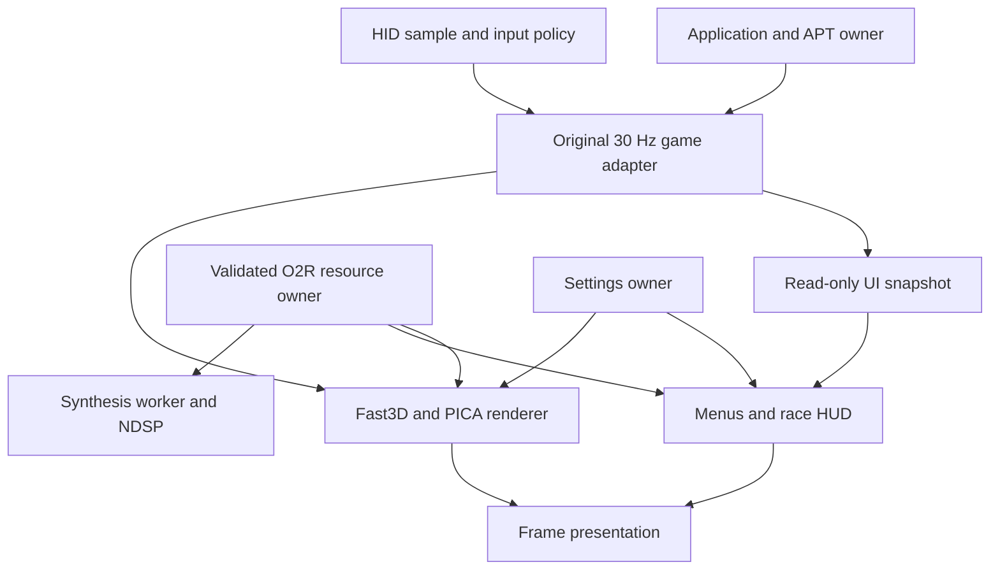

# Native 3DS architecture

The portable game is pinned under `third_party/SpaghettiKart`. Keep platform
behavior in `platform/3ds`; generated upstream adaptations belong in the build
directory, not in the submodule checkout. The CMake modules in `cmake/` describe
those adaptations by responsibility. A dependency update is a separate change.

## Runtime boundaries

| Owner | Responsibility and lifetime |
| --- | --- |
| `game_main_3ds.cpp`, `system_3ds.cpp` | Service initialization, APT lifecycle and final teardown. Graphics and audio consumers must stop before their resources are released. |
| `game_runtime_3ds.cpp`, `game_state_3ds.cpp` | Original game integration and immutable snapshots used by the bottom interface. Simulation remains 30 Hz; presentation can add a midpoint. |
| `input_3ds.cpp`, `input_policy_3ds.hpp`, `select_policy_3ds.hpp` | Normalize held/pressed/released input, resolve modal consumption and give the expanded diagnostic chord precedence over SELECT's single-button action. |
| `bottom_ui_3ds.cpp` | Citro2D textures, font atlases, bottom render target, dirty redraws, modal input and HUD composition. It owns texture replacement and deferred destruction. |
| `options_layout_3ds.hpp`, `options_actions_3ds.inc.cpp`, `options_view_3ds.inc.cpp` | Display option identity/order and shared drawing/touch row geometry. Moving an option does not change the persisted settings schema. |
| `settings_3ds.cpp` | Defaults, model-aware presets, manual Custom mode and configuration persistence. Applying a display preset preserves unrelated controls/audio/gameplay settings. |
| `gfx_citro3d.cpp`, `frame_interpolation_3ds.cpp` | PICA rendering and bounded recording/interpolation. Cache keys include state that affects output; invalid pairs fall back to a keyframe. |
| `native_mesh_format_3ds.hpp`, `native_mesh_draw_3ds.cpp` | Validated native cache and persistent indexed PICA drawing, integrated through guarded course working sets in the full-game configuration. See [Native mesh](NATIVE_MESH.md). |
| `native_dynamic_3ds.cpp`, `tools/generate_native_emit.py`, `tools/generate_native_embedded.py` | Full-game typed producers, bounded direct native frame replay and compiled embedded procedures. The native configuration does not select an opcode-interpreter fallback. |
| `resource_runtime_3ds.cpp`, `o2r_archive_reader.cpp` | Archive reads, decoded resources, ownership leases and cache eviction. A pointer to evictable storage must not escape its lifetime; UI decoders use scoped texture leases. |
| `audio_runtime_3ds.cpp`, `audio_ndsp_3ds.cpp` | Producer scheduling and NDSP buffer ownership. A buffer remains alive until synthesis and playback consumers have finished. |
| `solo_modes_3ds.cpp`, `auto_mode_3ds.cpp` | Solo race/Battle orchestration and bounded AUTO input pulses. Course transitions reset scene-specific state. |
| `diagnostics_3ds.cpp`, `performance_trace_3ds.cpp` | Bounded in-memory telemetry and explicit paused dumps. File output is outside measured gameplay intervals. |
| `updater`, `update_ui_3ds.inc.cpp` | Update transport, verification and user-facing workflow. RomFS resources remain available throughout updater work. |

## Execution and effects



The dependency arrows describe actual consumers; they do not create new global
managers. Main-thread preparation resolves input/modal transitions before the
original game polls its pad. UI drawing shares the renderer's open frame. The
frame owner closes/presents it and reaches the safe retirement boundary before
old UI textures are destroyed. The audio worker's synchronization protocol is
separate from a gameplay pause and from APT suspension.

| Effect | Owner and failure/recovery boundary |
| --- | --- |
| Archive read/decode | Resource runtime validates bytes, counts and indexes before publishing decoded storage; optional residency/cache can be surrendered under pressure. |
| UI source borrowing | `TextureLease3DS` holds image and palette tokens through intervening loads, CPU allocation and copying. Every scope/exception releases them. Uploaded GPU images own their copies. |
| Texture replacement | Build the new image first; publish it only when the old image can enter the bounded retirement queue. An unsubmitted failed replacement is safe to delete immediately. |
| Optional scaled art | Failed CPU/GPU preparation keeps the original image available. Partial variants remain owned; a partial font allocation is destroyed. This is a visual fallback, not a successful Modified-art claim. |
| Settings write | Flush/close the prepared file, then use recoverable replacement. Old contents survive a failed FAT replacement in the primary or `.bak` path. See [Compatibility](COMPATIBILITY.md). |
| EEPROM/ghost write | `libultra_3ds.cpp` owns `eeprom.bin` and `controller-pak.bin`, including legacy path reads; settings and art authoring do not change these formats. |
| Diagnostic dump | Main-thread diagnostic coordination pauses normal work; bounded histories are copied into explicit private output. Do not count that pause as ordinary race time. |
| Update/install | Updater owns network verification and install result; native UI exposes that result. Failure must not be reported as a completed install. |

## Menus and artwork

Display exposes Profile, Aspect Ratio, HUD Layout, Render, Distance, Frame Limiter
and Advanced. Advanced contains Filter, Loading Screens, HUD Meters, Menu Blur,
Scrolling Maps, Warning Widget, Textures and Back to Display. The main page has
seven rows; Advanced has eight rows.
Labels, actions, slider handling and unavailable-value feedback resolve the same
`DisplayOption` identity. Drawing and touch share their native screen geometry.

`assets/menu-hints/generate.py` authors the four fallback hint sprites from an original
pixel alphabet. The ordinary route composes original lettering from the owner
archive at initialization via `menu_hint_native_3ds.hpp`, preserving native
font pixels while adding an opaque backing. Owned decoded copies are released
after upload; evictable source pointers are not retained. It needs no ROM, external image, downloaded font or Pillow to
regenerate `source/art/menu_art_3ds.hpp`. Optional PNG previews need Pillow:

```sh
python3 platform/3ds/assets/menu-hints/generate.py
python3 platform/3ds/assets/menu-hints/generate.py --preview /tmp/mk64-hints
```

The sizes are 58x19 (L OPTION and R DATA), 127x19 (SELECT RANDOM CUP), and 81x19
(SELECT AUTO). Black is part of the same opaque RGBA texture as its lettering,
so scaling, fading and reveal apply to the complete button. No independent
screen-space rectangle should be added behind a hint. Textures are uploaded once
at UI initialization; there is no per-frame sprite generation or font loading.

`generate_icons.py` authors 25 original 18x18 square option tiles in one 128x128
atlas. The complete shaded illustration, including its shadow, is centered
inside a 12x12 area with balanced opposite margins (one pixel at most for
odd-sized shapes). Every face and edge is hand-authored on the pixel grid; no
automatic emboss filter or resampling changes the drawings. Top/left highlights and
bottom/right shading follow the native mode tiles. Rows meet without gaps.
The atlas uses 64 KiB; menu lettering uses a 128 KiB cyan/magenta font palette.
The rotating item-box cursor is removed. Selection uses the original 64-tick
triangular greyscale ramp, sampled from the engine's menu flash counter rather
than a separate wall clock. Labels retain contrast across the complete ramp.
Slider rails, marks and grips share the row's vertical center. They have no
opaque backing, so the row's selection ramp remains visible behind the rail.


LIGHT draws the original menu texture with linear sampling; MEDIUM/STRONG use
the bounded cached backdrop. Ordinary menu redraws do not rebuild the cache.

The options action/view fragments are included inside the bottom UI owner. They
share its private state and lifecycle; they are not separately compiled modules
or new global managers. Portable ordering/geometry remains in the policy header.

## Native-size interface sprites

`assets/native-ui/generate.py` authors eleven LAP/TIME/TOTAL, lap-counter and
clock canvases. `generate_maps.py` separately authors twenty course/battle maps
with explicit cubic curves, road widths and cutouts, at three native sizes per
map. RLE coverage is decoded and uploaded to LA4 only at resource load. The
original coordinate frame anchors racer/finish markers; generated art contains
no sampled reference bitmap. See [sprite authoring](NATIVE_SPRITES.md).

`title_credit_native_3ds.hpp` composes both title lines from the owner's runtime
copyright lettering and stroke recipes for missing characters. Copyright and
port credit share the face, outline, shadow and fade in one native 166x32
canvas. P/s/a use explicit native strokes; neither line is fractionally resized. The y descender and shadow remain inside its bounds. All texture
modes use this native-size overlay without aspect stretching. The stock copyright
is retained when the replacement texture is unavailable. The composed image
uses its own uploaded pixels and dimensions in every mode; the older packed
`@title_credit` port-only variant is not attached to this texture.

`native_ui_3ds.inc.cpp` belongs to the existing bottom-UI texture owner. It
prepares hand-authored Modified variants and separate bilinear Scaled variants.
Portraits have 18, 30, 40 and 48-pixel Scaled versions; items/ranking sprites
have their settled sizes. `native_sprite_3ds.hpp` performs only premultiplied-
alpha bilinear scaling. Modified falls back to Original for artwork whose
hand-authored replacement is still unfinished, including portraits/items/ranks.

One 512x256 LA4 atlas holds Scaled glyph coverage at heights 8 through 16. Menu
palettes share it through vertex tints. LA4 supplies white luminance and alpha;
A8's black RGB would disappear under multiplicative shading. Original and
Modified retain the original general menu alphabet. Course masks also use LA4,
including both Scaled source coverage and Modified hand-authored coverage.
The conveyor retains one size per style/course; the active course retains all
three. Color sprites use RGBA8. Settled rectangles snap to the physical screen
grid, while reveal/hit-spin animations transform complete sprites.

All three modes share resource ownership and deferred retirement. Changing
`ui_textures` selects prepared images without archive access, conversion or GPU
allocation. Optional allocation failure leaves the original available. Every
native allocation is freed with its parent; the shared glyph atlas is released
once at UI shutdown. Private archive previews compile the same portable scaler
and credit compositor, but their extracted output must stay outside Source.

## Memory and synchronization contracts

- `heap_partition_3ds.cpp` uses the actual process commit limit before services
  initialize. It reserves 20 MiB of linear memory for limits up to 80 MiB and
  24 MiB otherwise; total console RAM is not the process budget.
- The archive residency policy leaves at least 8 MiB of ordinary heap reserve.
  The streaming compressed cache is bounded to 2 MiB. Exhaustion must fall back
  or report failure; it must not silently increase a fixed budget.
- UI textures use Citro3D allocations and are released with `C3D_TexDelete`.
  Replacement moves the previous image into an eight-slot retirement queue;
  if that queue is full, keep the old live image and destroy the unsubmitted
  replacement. Drain only at the existing safe frame boundary.
- Four generated hints use 48 KiB of GPU backing storage in total: two 64x32
  and two 128x32 RGBA8 textures. Source arrays are read-only program data.
- Audio's worker stack is 64 KiB. Stop and join the producer before releasing
  its stack or shared NDSP buffers. A failed bounded join terminates the process
  rather than freeing memory still reachable by a live thread.
- Performance tracing has two fixed 256-tick histories. Preserve the trace's
  single-writer ownership and atomic cross-thread aggregate counters.
- GPU timings, renderer CPU timing and nested stage timers overlap. They must
  not be added together as if they represented independent frame costs.

## Change discipline

Keep a reproducible scene for rendering/timing changes. Record expected visual
changes separately from preservation checks. Add comments for ownership,
failure behavior, units and unusual platform constraints, rather than restating
individual assignments. Use the [validation guide](VALIDATION.md) to distinguish
portable tests, emulator observations and physical-console measurements.
